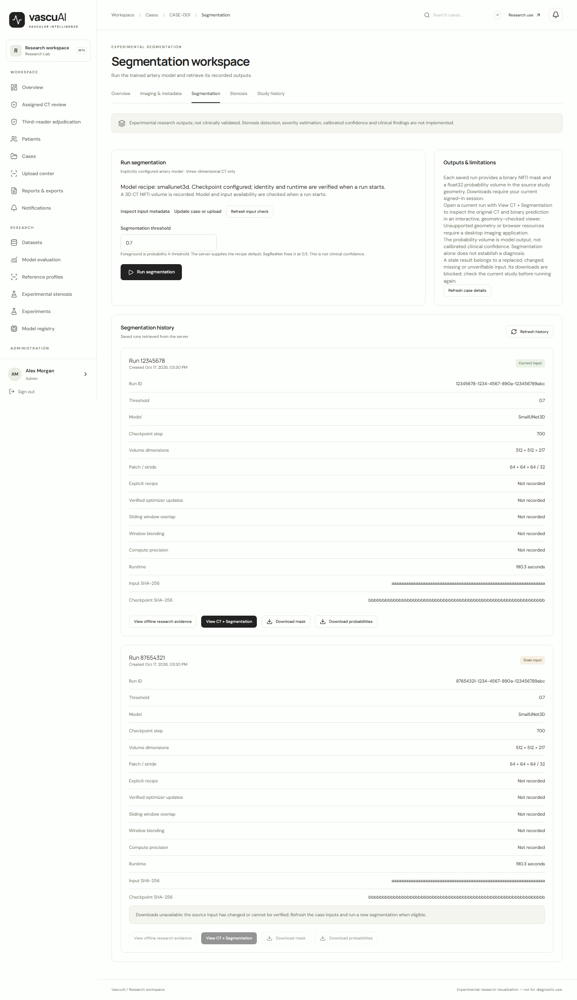
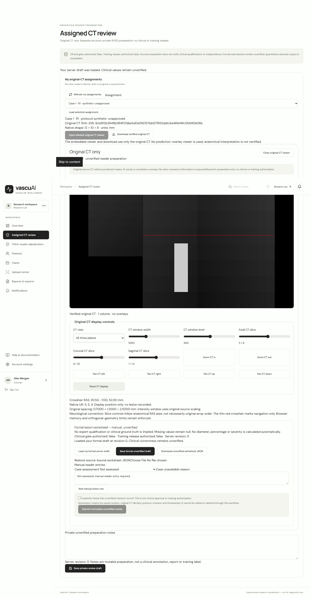

<h1 align="center">VascuAI</h1>

<strong>Artery Segmentation and Stenosis Detection Using Advanced Deep Learning Techniques</strong>

A research software prototype for imaging-study management, 3D CT viewing, artery segmentation experiments, offline evaluation, and controlled reviewer workflows.

<strong>Research prototype · Not for diagnosis · Not clinically validated</strong>

---

## 1. Project overview

VascuAI combines a React web application, FastAPI service, and PostgreSQL database. It provides user authentication and roles, patient and case management, NIfTI upload and validation, a geometry-aware CT viewer, optional externally supplied artery-segmentation checkpoints, evaluation import and comparison, reports, and software-separated review workflows.

The repository includes source code and documentation, not datasets, CT studies, masks, trained checkpoints, credentials, or private run artifacts. A fresh installation can run without model weights; segmentation execution remains unavailable until a compatible and authorized checkpoint is configured.

This is an internship research prototype, not a medical device. Successful upload, model execution, evaluation, image rendering, or reviewer workflow is not evidence of clinical accuracy.

## 2. Project objectives

- Preserve traceable links between cases, source volumes, model runs, evaluation records, and reviews.
- Validate uploaded image files and geometry before processing.
- Provide role-appropriate workflows and audit records.
- Keep unverified or missing medical measurements explicitly unavailable.
- Separate synthetic and experimental work from ordinary patient-case reporting.

## 3. Features and verified boundaries

| Capability | Current implementation |
| --- | --- |
| Authentication | JWT sessions, Argon2id password hashing, role checks, session revocation, and audit events. |
| Patients and cases | Authenticated APIs and UI for case discovery and management according to role. |
| Image handling | Bounded NIfTI (.nii/.nii.gz) upload, validation, geometry/metadata extraction, and private storage. |
| Viewer | Browser viewing for supported geometry, with slice, window/level, zoom, pan, and display controls. Resource and geometry limits apply. |
| Segmentation | Experimental artery segmentation through optional external checkpoint mounts. Base images contain no model weights. |
| Evaluation | Protected artifact upload/import, source/model/split provenance, summaries, case metrics, and comparisons. Missing values stay null. |
| Review | Owner-private drafts, separated R1/R2 assignment access, CT-only review, immutable submissions, third-reviewer adjudication, and versioned amendments in local source. Software does not verify reviewer qualifications or real-world independence. |
| Milestone 3 research | Synthetic candidate/measurement experiments, optional synthetic-only CNN and Grad-CAM, offline evidence, and bounded real-volume CT/mask QC. No validated stenosis detector is available. |

Local source is not necessarily the version running in a browser or Docker deployment. Check [release readiness](RELEASE_READINESS.md) for deployment evidence and blockers.

### Milestone status (from the saved project evidence)

| Milestone | Evidence-based status |
| --- | --- |
| 1 — Foundation | Authentication, case-management, upload, architecture, and setup software are present. Historical week-by-week evidence and final mentor sign-off are not independently established. |
| 2 — Segmentation | Saved SegResNet training and 50-case validation evidence, plus a 50/50 baseline comparison and 100 verified masks, are recorded. The compared recipes use heterogeneous protocols, so this is not a controlled architecture-only comparison or clinical validation. |
| 3 — Stenosis | Partial, synthetic/research only. Synthetic geometry and CNN experiments exist, but suitable authorized lesion labels, clinical review, real-image validation, calibrated confidence, and patient-integrated stenosis outputs are unavailable. |
| 4 — Integration and reporting | Core app, evaluation/reporting and reviewer workflow are implemented in local source. Recorded software gaps include assignment withdrawal/reassignment, amendment-aware adjudication, full external packet/evidence-receipt and coverage operations, and real protocol/qualification/independence sign-off. Final release/deployment verification also remains unresolved; latest source is not proof of a staging deployment. |

See the linked milestone reports for scope, exact artifacts, protocol differences, and current blockers.

## 4. Screenshots

The following are genuine browser-rendered application captures from regression runs. All displayed accounts, cases, hashes, volumes, and outputs are synthetic QA fixtures. They are not patient studies or clinical-result evidence.

<em>Segmentation workspace and history layout. Displayed run details are synthetic test data.</em>

<em>CT-only review controls rendered with a small synthetic volume. No real CT is included in these screenshots.</em>

A local screenshot containing a real CT exists in the project documentation, but its source and public redistribution status have not been cleared. It is intentionally not copied into the README assets. Do not publish a real study image until provenance, license, consent, and redistribution rights have been reviewed.

## 5. Architecture

~~~mermaid
flowchart LR
  User[Research user] --> UI[React application]
  UI --> Proxy[Nginx or Vite API proxy]
  Proxy --> API[FastAPI REST API]
  API --> Auth[JWT and role authorization]
  API --> DB[(PostgreSQL)]
  API --> Files[Private /data storage]
  API --> Eval[Evaluation and reporting]
  API --> Seg[Optional segmentation runtime]
  Seg --> Weights[External read-only model checkpoint]
  API --> Synthetic[Authenticated synthetic-only research endpoints]
  CLI[Offline research CLI] --> Evidence[Source-bound JSON evidence files]
  Evidence -->|Explicit source-bound verification| API
  API --> Review[Draft, assignment, submission, adjudication]
~~~

Default Docker Compose runs PostgreSQL, API, and Nginx. The web container publishes a loopback host port; the API and database have no host-published ports. Database migrations are explicit and are not run on API startup.

### Technology stack

| Layer | Actual technologies |
| --- | --- |
| Frontend | JavaScript, React 19, React Router, Vite, Tailwind CSS, Axios, Lucide, Chart.js, Niivue and NIfTI readers. |
| Backend | Python 3.14, FastAPI, Pydantic, SQLAlchemy, Alembic, Uvicorn, NiBabel, NumPy, SciPy, scikit-image. |
| Database | PostgreSQL 18; SQLite is restricted to test mode. |
| Security | JWT (HS256), Argon2id, role-based authorization and audit events. |
| Packaging and tests | Docker, Compose, Nginx, pytest, Node test runner, Playwright, disposable PostgreSQL helper. |

The main frontend is JavaScript, not TypeScript. MongoDB and Plotly are not used. AWS/Azure deployment recipes are not included. The project does not train every model architecture listed in proposals.

## 6. Repository structure

~~~text
backend/app/                 API, auth, models, routes and services
backend/migrations/versions/  Alembic migration history
backend/scripts/             Admin bootstrap, research and test helpers
backend/tests/               API, authorization, migration and research tests
frontend-react/src/           React pages, components, API clients and viewer
frontend-react/tests/         Unit, contract and browser tests
deploy/                       Dockerfiles, Compose overlays and Nginx
docs/                         API, architecture, dataset, viewer and safety guides
MILESTONE_COMPLETION_REPORT.md
MILESTONE_TASK_STATUS.md
TEST_EVIDENCE.md
RELEASE_READINESS.md
~~~

## 7. Prerequisites and supported versions

- Python 3.14.7 and PostgreSQL 18 are recorded in the backend setup guide.
- Node.js 22 with npm for the frontend.
- Docker Engine and Docker Compose plugin for container setup.
- Optional PyTorch and a separately obtained checkpoint only for the corresponding model runtime.

PostgreSQL is the normal application database. SQLite is allowed only with TESTING=true. Keep secrets, private environment files, study data, datasets, and model artifacts outside Git.

## 8. Clone and configure

~~~sh
git clone https://github.com/vimalluuu/vascuai.git
cd vascuai
~~~

A clone has no seeded accounts, database, patient studies, or model weights.

### Environment variables

For Docker, copy the example:

~~~powershell
Copy-Item deploy/.env.example deploy/.env
~~~

Set a unique POSTGRES_PASSWORD, a newly generated SECRET_KEY of at least 32 bytes, and a matching DATABASE_URL using the Compose hostname db. URL-encode reserved password characters. The values in DATABASE_URL must match POSTGRES_USER, POSTGRES_DB, and POSTGRES_PASSWORD. For the example values, the URL shape is:

~~~text
postgresql+psycopg://vascuai:<URL-encoded-password>@db:5432/vascuai
~~~

The hostname db is the Compose service name and is used only by containers on the Compose network. For a backend running directly on your computer, use localhost instead. CORS_ORIGINS can remain [] for same-origin access. Keep deploy/.env private and untracked.

Generate a random hex key locally:

~~~sh
python -c "import secrets; print(secrets.token_hex(32))"
~~~

For a manual backend install, copy backend/.env.example to backend/.env. Set SECRET_KEY and DATABASE_URL for the intended local PostgreSQL database, normally localhost:5432. Provision the database role separately. UPLOAD_DIR and OUTPUT_DIR should point to private local storage. The model checkpoint is unset by default.

The frontend defaults to /api/v1. Vite proxies /api and /health to http://localhost:8000 and serves the UI at http://localhost:5173. frontend-react/.env.example contains only public API-path configuration. Never put secrets in VITE_* values; these are visible in browser bundles.

## 9. Docker setup (recommended for a new local instance)

These commands initialize a new local stack. Review the resolved config before use; this is not an instruction to replace an existing deployment.

~~~sh
docker compose --env-file deploy/.env -f deploy/compose.yaml config --quiet
docker compose --env-file deploy/.env -f deploy/compose.yaml build
docker compose --env-file deploy/.env -f deploy/compose.yaml up -d db
docker compose --env-file deploy/.env -f deploy/compose.yaml ps
~~~

Apply the reviewed schema and create the first administrator:

~~~sh
docker compose --env-file deploy/.env -f deploy/compose.yaml run --rm api python -m alembic upgrade head
docker compose --env-file deploy/.env -f deploy/compose.yaml run --rm api python -m app.database.create_admin
~~~

Start the full stack and inspect status:

~~~sh
docker compose --env-file deploy/.env -f deploy/compose.yaml up -d
docker compose --env-file deploy/.env -f deploy/compose.yaml ps
~~~

Open the frontend at http://127.0.0.1:8080. Liveness is at /health and database readiness is at /health/ready. The current Nginx configuration proxies /api/ and /health only; it does not proxy /docs or /openapi.json, so those paths are not Docker-hosted Swagger endpoints. The base Compose file binds only the web service to 127.0.0.1:8080; it does not publish PostgreSQL or API ports. With the manual backend running, use http://127.0.0.1:8000/docs for Swagger UI.

~~~sh
docker compose --env-file deploy/.env -f deploy/compose.yaml logs --follow api
docker compose --env-file deploy/.env -f deploy/compose.yaml logs --follow web
docker compose --env-file deploy/.env -f deploy/compose.yaml restart
docker compose --env-file deploy/.env -f deploy/compose.yaml stop
docker compose --env-file deploy/.env -f deploy/compose.yaml start
~~~

Stopping preserves named volumes. PostgreSQL uses postgres-data and private uploads/outputs use study-data at /data. Do not run down -v, prune, or delete volumes as routine troubleshooting.

## 10. Manual development setup

### Backend

From the repository root in PowerShell, open a backend terminal and change directory first:

~~~powershell
Set-Location .\backend
python -m venv .venv
.\.venv\Scripts\python -m pip install -r requirements-dev.txt
Copy-Item .env.example .env
~~~

For a fresh local PostgreSQL database, provision the role and database as described in [PostgreSQL and migrations](#11-postgresql-and-migrations). Configure the private backend/.env with localhost and the same local role/database values. Then, still from backend/:

~~~powershell
.\.venv\Scripts\python -m alembic upgrade head
.\.venv\Scripts\python -m app.database.create_admin
.\.venv\Scripts\python -m uvicorn app.main:app --reload --host 127.0.0.1 --port 8000
~~~

Backend: http://127.0.0.1:8000; Swagger/OpenAPI: http://127.0.0.1:8000/docs; liveness and readiness: /health and /health/ready.

### Frontend

In a second PowerShell terminal from the repository root:

~~~powershell
Set-Location .\frontend-react
npm ci
npm run dev -- --host 127.0.0.1
~~~

Frontend: http://127.0.0.1:5173. Stop each development process with Ctrl+C. On Unix-like systems use python3 -m venv .venv and .venv/bin/python instead of the Windows venv executable.

## 11. PostgreSQL and migrations

For manual development, PostgreSQL is expected on localhost:5432. If you are creating a new local database, connect interactively as a PostgreSQL administrator (for example, from PowerShell with PostgreSQL's psql available on PATH):

~~~sh
psql -h localhost -p 5432 -U postgres -d postgres
~~~

At the psql prompt, create a dedicated application login, set its password through psql's secure prompt, and create a database owned by that role:

~~~text
CREATE ROLE vascuai LOGIN;
\password vascuai
CREATE DATABASE vascuai OWNER vascuai;
~~~

Run these only for a new local setup when the role/database do not already exist. If either name exists, inspect it; do not drop or replace it to make setup commands succeed. Set backend/.env DATABASE_URL to `postgresql+psycopg://vascuai:<URL-encoded-password>@localhost:5432/vascuai` using the password you entered at the prompt.

The Docker Compose database is initialized from POSTGRES_USER, POSTGRES_DB, and POSTGRES_PASSWORD in deploy/.env. The API's DATABASE_URL must use those same credentials and database name, but hostname db (the Compose service), not localhost. localhost from inside the API container refers to that container itself.

Current source migration head: 0016_review_amendments. Run migration commands from backend/ with the intended private .env loaded:

~~~sh
python -m alembic current
python -m alembic heads
python -m alembic history
python -m alembic upgrade head
~~~

current requires a database connection. heads and history inspect migration metadata. Only run upgrade against a deliberately provisioned new/local database or an explicitly approved maintenance target after backup, restore, identity, and migration review. Do not use stamp, downgrade, or destructive recreation to bypass an unknown schema.

## 12. Creating an administrator

There is no public Admin signup, default password, or seeded demo account.

For the first Admin on a newly initialized database, run python -m app.database.create_admin from backend/, or the equivalent Docker command above. The script securely prompts for name, email and password, refuses an email that already exists, creates an active Admin and records an audit event.

Public registration permits Clinician, Researcher, and DataScientist roles; it cannot assign Admin. An existing Admin can list users and change an existing user's role or active status through User management. A person must first have an account before an Admin can change access. Role changes revoke that user's sessions. Do not share accounts.

> **Security warning:** The unauthenticated registration route is currently available at `/api/v1/auth/register` and accepts the Clinician, Researcher, and DataScientist roles. The current application settings do not document an application-level switch to disable registration. Restrict network ingress and control who can reach registration before exposing VascuAI to untrusted users. Do not assume loopback-only local Compose settings protect a separately hosted deployment.

## 13. Optional model and artifact setup

The default API image uses INSTALL_MODEL=false and contains no model weights or active stenosis provider.

For a manual SmallUNet3D setup, set `VASCULAI_MODEL_CHECKPOINT` in the private
backend environment to the verified external checkpoint path. This legacy loader
computes and records the checkpoint identity when loading; it does not require
`VASCULAI_MODEL_CHECKPOINT_SHA256`. From `backend/`, install the optional CPU
runtime with:

~~~powershell
python -m pip install -r requirements-model.txt --index-url https://download.pytorch.org/whl/cpu
~~~

SegResNet additionally requires `VASCULAI_MODEL_CHECKPOINT_SHA256` to be the
independently verified 64-character lowercase SHA-256 of the checkpoint. Its
manual configuration is:

~~~text
VASCULAI_MODEL_ARCHITECTURE=segresnet-1mm-v1
VASCULAI_MODEL_CHECKPOINT=/absolute/private/path/best.pt
VASCULAI_MODEL_CHECKPOINT_SHA256=<64-character-lowercase-SHA-256>
~~~

From `backend/`, install the CPU model runtime and MONAI requirements:

~~~powershell
python -m pip install -r requirements-model.txt --index-url https://download.pytorch.org/whl/cpu
python -m pip install -r requirements-segresnet.txt
~~~

The SegResNet recipe fixes its inference threshold at 0.5. See the
[segmentation runtime notes](backend/app/services/segmentation/README.md) for
its checkpoint contract and preprocessing limits.

- SmallUNet3D is an optional legacy artery-segmentation recipe using deploy/compose.model.yaml and a read-only external directory mounted at /models. The overlay expects artery_unet_10case_weighted_step700.pt. The historical training-run provenance is unresolved; the checkpoint's step label is not verified optimizer history.
- SegResNet is separate: deploy/compose.segresnet.yaml expects an external best.pt plus SEGRESNET_ARTIFACT_DIR and SEGRESNET_CHECKPOINT_SHA256. Optional PyTorch/MONAI dependencies are required. Do not combine the model overlays.
- The experimental stenosis CNN is separate and synthetic-only. Its checkpoint is outside the repository and must not be used on patient cases.

Verify checkpoint source, hash, architecture, preprocessing, and permissions before configuration. Do not fetch arbitrary weights, bake weights into images, bypass readiness, or use random weights.

For a new isolated local stack, configure MODEL_ARTIFACT_DIR in deploy/.env and use both Compose files when selecting SmallUNet3D:

~~~sh
docker compose --env-file deploy/.env -f deploy/compose.yaml -f deploy/compose.model.yaml config --quiet
docker compose --env-file deploy/.env -f deploy/compose.yaml -f deploy/compose.model.yaml build api
docker compose --env-file deploy/.env -f deploy/compose.yaml -f deploy/compose.model.yaml up -d api
~~~

For SegResNet, configure `SEGRESNET_ARTIFACT_DIR` and the verified
`SEGRESNET_CHECKPOINT_SHA256` in `deploy/.env`, then select
`deploy/compose.segresnet.yaml` instead:

~~~sh
docker compose --env-file deploy/.env -f deploy/compose.yaml -f deploy/compose.segresnet.yaml config --quiet
docker compose --env-file deploy/.env -f deploy/compose.yaml -f deploy/compose.segresnet.yaml build api
docker compose --env-file deploy/.env -f deploy/compose.yaml -f deploy/compose.segresnet.yaml up -d api
~~~

Keep the selected overlay on every later Compose command that inspects, starts,
stops, or updates this model-enabled stack; otherwise Compose resolves a different
service configuration. Do not combine `compose.model.yaml` and
`compose.segresnet.yaml`. These examples do not authorize changing an existing
deployment. Read the model guide and deployment review first.

## 14. API documentation

FastAPI serves Swagger UI at /docs and OpenAPI JSON at /openapi.json when you connect to the backend directly; with the manual setup, Swagger UI is http://127.0.0.1:8000/docs. The default Docker Nginx configuration does not proxy either path, and the API has no published host port, so these docs are not available through http://127.0.0.1:8080. Versioned APIs use /api/v1. Routes include authentication/admin, patients/cases, NIfTI ingestion, segmentation, evaluation, reporting, research, and reviewer workflows. Use generated OpenAPI for exact contracts of the running revision.

## 15. User workflow

1. Sign in with an individually provisioned account.
2. Select an authorized patient/case.
3. Upload an authorized NIfTI CT and review validation and geometry.
4. Inspect the volume using supported viewer controls.
5. If a compatible model is explicitly configured and the user is authorized, run experimental artery segmentation and inspect its source-bound history.
6. Browse imported offline evaluation records and comparisons.
7. Use assigned CT-only review only for assigned accounts; server-side isolation is implemented, but software cannot establish reviewer qualifications or independence.
8. Use synthetic stenosis research only with synthetic inputs. It does not authorize clinical reporting or model training.

Unavailable values should remain unavailable; an empty evaluation or missing model is not a reason to invent data.

## 16. Testing

Frontend unit/contract tests, lint, and production build (from frontend-react/):

~~~sh
npm ci
npm test
npm run lint
npm run build
~~~

Playwright browser tests:

~~~sh
npm run test:e2e
~~~

The configured runner starts the Vite test server. Actual-API browser tests are
opt-in and use these settings:

- `PLAYWRIGHT_LIVE_API_URL` points the Playwright Vite proxy at a credential-free
  loopback FastAPI origin. Offline-research live tests use it with disposable
  PostgreSQL and source-bound synthetic evidence; see
  [test_offline_research_live.py](backend/tests/test_offline_research_live.py)
  and [offline-research-live-runner.mjs](frontend-react/tests/offline-research-live-runner.mjs).
- `VASCUAI_LIVE_FIXTURE` is generated by the disposable PostgreSQL acceptance
  harness when `VASCUAI_LIVE_ACCEPTANCE=1` is explicitly set. The stenosis live
  browser test reads that synthetic fixture; see
  [test_stenosis_acceptance.py](backend/tests/test_stenosis_acceptance.py) and
  [stenosis-live.spec.js](frontend-react/tests/e2e/stenosis-live.spec.js).
- The real-volume-QC browser test uses the `VASCUAI_REAL_VOLUME_*` family:
  `VASCUAI_REAL_VOLUME_API_URL`, `VASCUAI_REAL_VOLUME_RESEARCH_EMAIL`,
  `VASCUAI_REAL_VOLUME_RESEARCH_PASSWORD`,
  `VASCUAI_REAL_VOLUME_CLINICIAN_EMAIL`,
  `VASCUAI_REAL_VOLUME_CLINICIAN_PASSWORD`,
  `VASCUAI_REAL_VOLUME_FIXTURE_DIR`,
  `VASCUAI_REAL_VOLUME_RESPONSE_MARKER`, and
  `VASCUAI_REAL_VOLUME_EVIDENCE_PATH`. It requires a disposable API and database,
  disposable test accounts, and synthetic NIfTI fixtures named `ct-valid.nii`,
  `mask-valid.nii`, `mask-dimensions-mismatch.nii`, and
  `mask-affine-mismatch.nii`. The test sends CT/mask uploads through React to the
  actual FastAPI route; it is not a patient-data test. See
  [real-volume-live.spec.js](frontend-react/tests/e2e/real-volume-live.spec.js)
  for its inputs and assertions.

A skipped live test has not passed. Never point test tooling at staging,
production, or a database containing real studies.

Backend tests (from backend/):

~~~powershell
.\.venv\Scripts\python -m pytest -q --cov=app --cov-report=term
.\.venv\Scripts\python scripts\test_frontend_contract.py
.\.venv\Scripts\python -m pip check
~~~

A disposable PostgreSQL helper is available on Windows:

~~~powershell
.\.venv\Scripts\python scripts\test_postgres.py --bin "C:\Program Files\PostgreSQL\18\bin"
~~~

Review helper options before running; it manages its temporary cluster. SQLite-only test runs skip PostgreSQL-specific integration/concurrency cases. The latest saved counts, exact commands, skips, warnings, and limits are in [TEST_EVIDENCE.md](TEST_EVIDENCE.md); they describe recorded runs and are not a fresh guarantee for every checkout.

The saved 25 November full-suite run records backend 1006 passed / 197 skipped / 3 warnings, frontend 658 passed, and browser 221 passed / 3 opt-in skips. A later focused real-volume-QC verification records backend 17 passed / 1 optional-model skip, frontend 664 passed, and 6 focused browser tests passed. These are separate test scopes; PostgreSQL-specific and optional PyTorch coverage must be read with the skip notes in TEST_EVIDENCE.md.

## 17. Troubleshooting

| Problem | Safe checks |
| --- | --- |
| API startup fails | Check private settings, DB readiness, selected Python environment, and sanitized logs. Do not print the credential-bearing database URL. |
| /health works but /health/ready fails | Liveness does not test PostgreSQL. Check DB health, host, role, and schema revision. |
| Login fails | Confirm the account exists, is active, and has the expected role. No account is seeded by cloning. |
| Unknown Alembic revision | Stop. Verify repository and database identity and review backup and migration path. |
| Segmentation unavailable | Check the model config and external checkpoint identity/hash. Never bypass readiness or use random weights. |
| Upload rejected | Check NIfTI format, size and voxel limits, finite data, supported geometry, and private storage capacity. |
| Blank/refused viewer | Check file integrity and geometry/browser limits. Some geometries need desktop imaging software. |
| Empty analytics/evaluations | No records may have been imported. Do not fabricate values. |
| Test skipped | Check markers and opt-in settings. A skip is not a pass. |

## 18. Deployment guidance

Compose is a local/self-hosted reference, not proof of a production deployment. Before a controlled deployment, use reviewed immutable images, private secret management, HTTPS at a trusted reverse proxy, restricted network access, verified backups, reviewed migrations, monitoring, storage limits, and rollback procedures.

The default web port is loopback-only and not remotely reachable. Do not bind it to all interfaces as a shortcut. Remote access needs an approved secure ingress path. No verified AWS or Azure deployment recipe is provided. See [deploy/README.md](deploy/README.md) for routing and container details; review its revision-specific instructions before applying them to current source.

## 19. Limitations and research status

- No clinically validated stenosis classifier or patient-volume stenosis inference is available.
- Clinical severity, percentage narrowing, calibrated confidence, and patient-integrated stenosis XAI are not validated outputs.
- Synthetic severity/measurement experiments and the optional synthetic-only CNN are not clinical evidence. Recorded synthetic test performance is weak; synthetic Grad-CAM is restricted to synthetic inputs.
- Real-volume QC validates CT/mask readability and geometry and reports bounded mask/topology diagnostics. Uploaded mask semantics are not verified as lumen or lesion annotation; lesion candidates and lumen measurements remain unavailable from that workflow.
- Suitable authorized lesion-level labels and qualified independent clinical review are missing for clinical validation.
- Reviewer software separation does not prove real-world qualification or independence.
- ImageCAS-X v2 licensing is unresolved in the recorded audit. Do not redistribute its files or assume mask rights grant CT rights.
- clinical_gate_authorized=false and training_release_authorized=false.

See [Milestone 3 boundaries](docs/milestone3-research-completion.md), [dataset audit](docs/imagecas-dataset-audit.md), and [release readiness](RELEASE_READINESS.md).

## 20. Security and data handling

- Keep .env files, passwords, keys, access tokens, database dumps, and model checkpoints out of Git.
- Use individual accounts and least-privilege roles.
- Keep CTs, masks, and derived files in private storage with appropriate access and retention controls.
- Do not put patient identifiers in names, screenshots, logs, or issue reports.
- Default Compose does not publish API or PostgreSQL ports; web is bound to loopback.
- Use HTTPS for remote access and exact CORS origins. VITE_* values are public, build-time settings, never secrets.
- Back up database and private storage together and verify restoration before migrations or release.
- Review source-specific dataset permissions; access is not permission to redistribute.

## 21. Contributors and acknowledgements

Project team contributors: Vimal, Saish, Roja, and Muskan. This is project-team attribution, not a legal ownership determination; confirm preferred names and contribution descriptions before public release.

Developed for the Infosys Springboard internship review. Credit dataset authors, publications, and software dependencies according to their original terms. No dataset is included. Attribution does not grant redistribution rights.

## 22. Further documentation

- [Architecture](docs/project-architecture.md)
- [Milestone report](MILESTONE_COMPLETION_REPORT.md)
- [Milestone task status](MILESTONE_TASK_STATUS.md)
- [Test evidence](TEST_EVIDENCE.md)
- [Release readiness](RELEASE_READINESS.md)
- [Evaluation API](docs/evaluation-api.md)
- [NIfTI viewer](docs/frontend-segmentation-viewer.md)
- [Dataset preparation](docs/ccta-dataset-preparation.md)
- [ImageCAS audit](docs/imagecas-dataset-audit.md)
- [Reviewer workflow](docs/ct-review-assignments.md)
- [Deployment reference](deploy/README.md)
