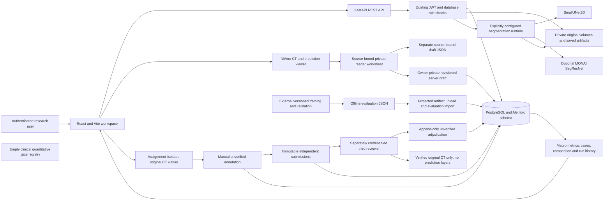

# VascuAI architecture and capability boundaries

This describes the implemented research prototype, including pending local changes.
It is not a claim that the latest source is deployed or clinically validated.

## Application and storage

- React/JavaScript, Tailwind/custom styles, Lucide, Chart.js and NiiVue form the frontend.
- FastAPI/Pydantic implement the versioned API; SQLAlchemy and PostgreSQL persist
  users, cases, upload metadata, segmentation/evaluation evidence and research reviews.
- Alembic versions schema changes. Preparing a migration is separate from permission
  to apply it to any application database.
- Private files retain original volumes and run artifacts. The frontend retrieves
  protected files through the API; browser rendering does not grant public file access.
- Docker/Compose provide the local deployment structure. Cloud storage, cloud database,
  AWS/Azure deployment, serving-registry controls and a training job runner are not implemented.

## Identity and permissions

`backend/app/core/roles.py` is the backend authority. The frontend policy is tested
against it. Clinician/Admin can write clinical-workspace cases and run segmentation;
Researcher/DataScientist have the existing case-read permissions. Evaluation import
is restricted to DataScientist/Admin. Administration remains Admin-only.

Authorization reads the current database role/account state rather than trusting a
role supplied by a client. The prototype's case-read policy is role-based; assignment-level
review access is separately assignment-bound. Assigned R1/R2 accounts are globally
restricted to their own original-CT workflow; prediction, evaluation, legacy case,
image and result routes are denied server-side. Adjudicator accounts have a separate
allowlist and cannot read independent readers' mutable drafts.

## Medical-volume and model path

Original NIfTI intake validates file/payload/geometry bounds and preserves source bytes.
The selected CT recipe defines normalization, spatial sampling and threshold behavior.
An explicitly selected model/checkpoint produces saved source-bound masks/probabilities;
those probabilities are not calibrated clinical confidence. The legacy recipe remains
separate from the optional SegResNet recipe; there is no silent model replacement.

The viewer validates actual source bytes against the saved run and checks geometry
before displaying CT and predicted-mask overlays. Unsupported oblique/sheared browser
geometry remains refused. Rendering and valid headers do not prove anatomical alignment.

## Evaluation and research reporting

Actual offline evaluations enter through protected upload/import with stored-artifact,
checkpoint, split, case-membership and metric provenance. Repeated identical imports
are idempotent; conflicts fail. Headline metrics are unweighted case macro-averages;
pooled micro metrics are labeled separately. Exact case membership is required for comparison.

Count-derived supplementary metrics cannot reconstruct Hausdorff or average surface
distance. Missing measurements remain unavailable rather than being replaced by zero.
JSON/CSV exports and browser print/PDF views preserve research limitations.

## Reader preparation and clinical boundary

The local worksheet allows authorized readers to bookmark the current crosshair in
original native IJK coordinates, enter proposed lesion metadata and manual measurements,
and download/restore a draft bound to the exact CT and saved segmentation. It does not
calculate a narrowing percentage or choose a severity category.

Edits stay in browser memory until explicitly saved to the owner's private server
draft or downloaded as separate local JSON. Server updates use revision conflicts;
reloading and resolving changes is explicit, with no automatic overwrite or merge.
Drafts are not submitted application reviews or expert labels. They disclose a predicted overlay,
cannot claim independent/blinded review, and are rejected by normal report JSON exports.
The separate CT-only workflow now provides R1/R2 assignment, bounded embedded CT
viewing, manual source-bound annotations, revision history and explicit immutable
submissions. Seven landmark fields use the original native IJK grid and full affine
inverse; no caliper distance, percentage or severity is automatically inferred.

Third-reader assignment requires both frozen submissions and a separately verified,
current credential record. There is no public self-certification endpoint and no real
credential is seeded. Third-reader decisions reference original lesion identifiers,
retain disagreement/unresolved outcomes and append hash-linked immutable history.
Human qualification, genuine independence, expert ground truth and protocol validation
are not established by software tests. Clinical and training release stay false even
after adjudication. Amendments and reassignment need a separately reviewed process.

The third reader now has an embedded source-bound CT pane using the shared display
controls with its own owner/credential/frozen-parent loader. Session changes clear
private evidence; source/access failure clears pixels. Source/protocol-linked
documentation counts are not anatomical coverage. Credential eligibility is filtered
in SQL before pagination. Full external packet receipts, amendments, reassignment
and withdrawal remain incomplete lifecycle work, without bypassing immutable records.

Prepared schema additions 0013–0015 have only been exercised in disposable test
databases. This document does not authorize applying them to local or staging data.

The existing case-review endpoint records only inspection of a saved segmentation
for research workflow purposes. It does not establish segmentation accuracy or a
clinically approved stenosis result. Both clinical quantitative gate registries remain empty.

## Verification and release

Relevant source tests include `backend/tests/test_access_policy.py`,
`backend/tests/test_evaluations.py`, `backend/tests/test_segresnet_runtime.py`,
`frontend-react/tests/reporting.test.js` and
`frontend-react/tests/e2e/annotation-draft.spec.js`.

Synthetic software-test records are distinct from actual model validation evidence.
Neither passing tests nor a research reference profile is clinical validation.
Source review, image verification, a current verified backup/restore, approved deployment
and a role-by-role rehearsal are separate release steps. No deployment occurs from
opening the application or this document.

The portable [as-implemented wireframes](ui-wireframes.html) document current
navigation and safety states. They were reconstructed during closeout, not presented
as original Week 1 design evidence or as proof of live deployment.
